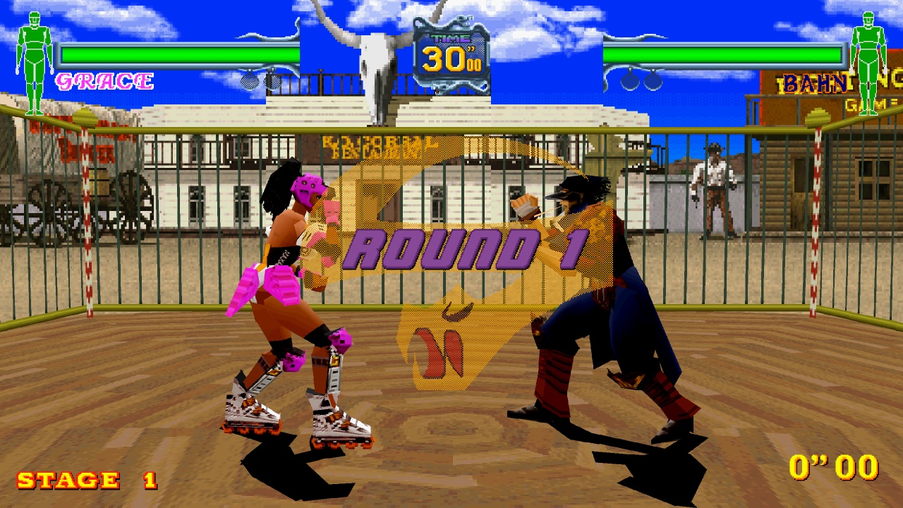
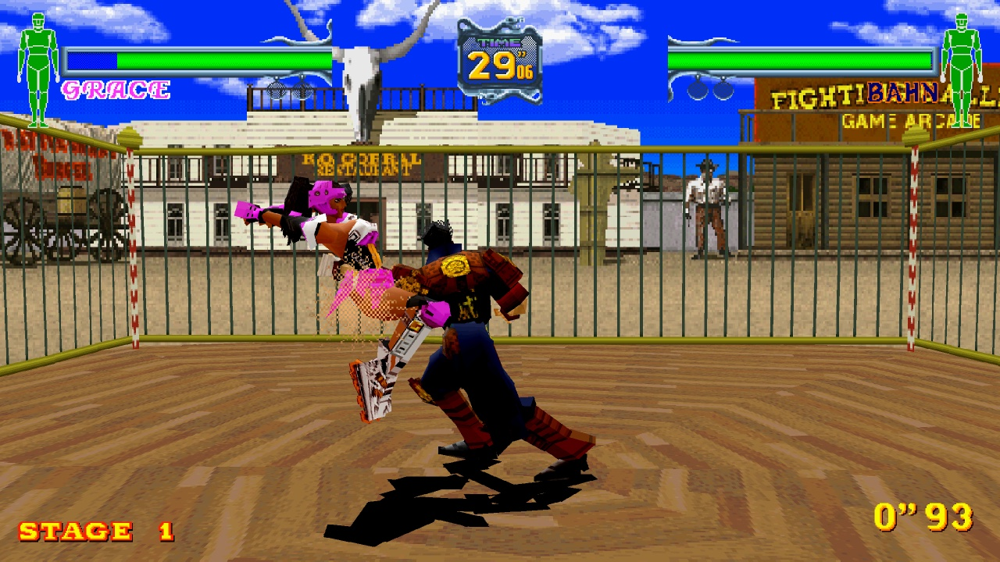
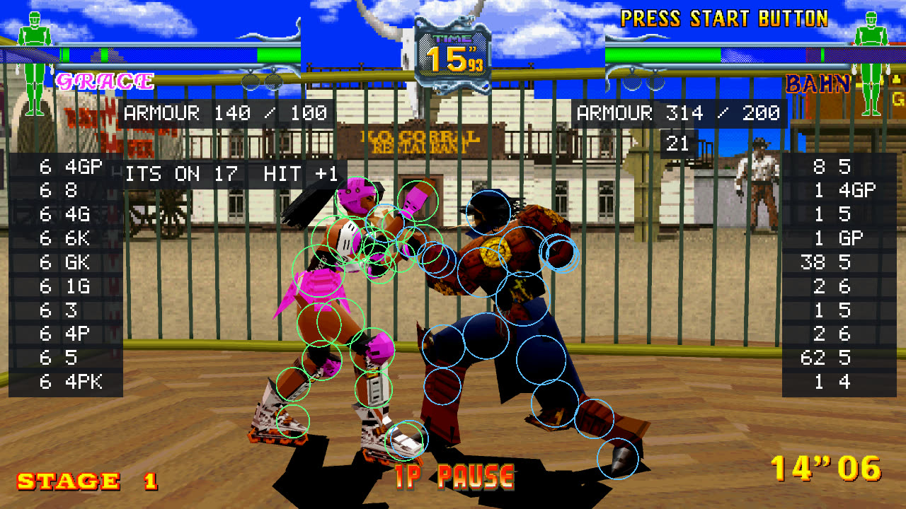
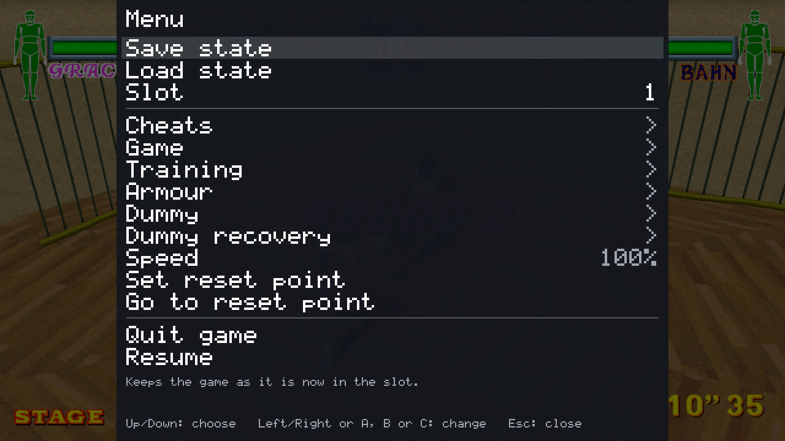
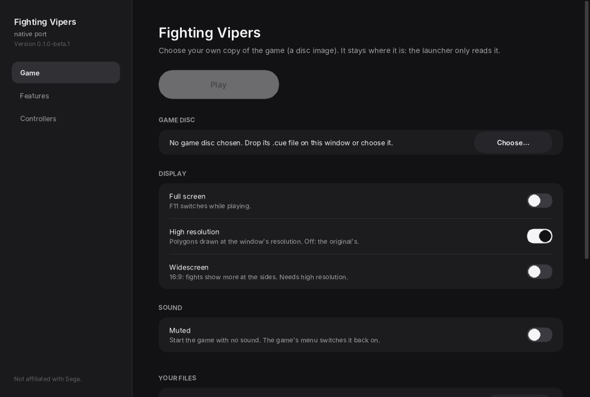
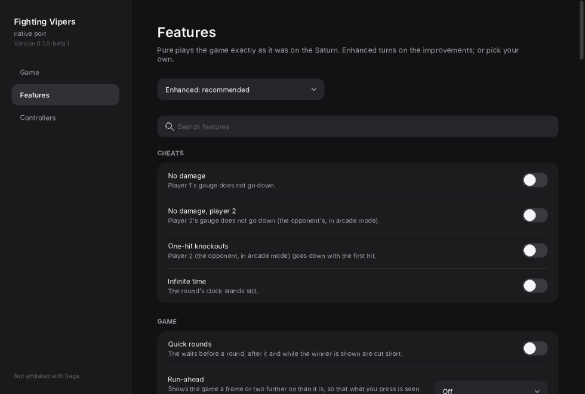

# Fighting Vipers Recomp

An unofficial native PC port of *Fighting Vipers* (Sega AM2, Sega Saturn, 1996) for macOS, Linux,
SteamOS and Windows, made by static recompilation, with widescreen, high resolution and a training
mode.

> **Beta.** Fights, menus and the opening movie run, but it has been tested far more by scripts than
> by hand, and on few machines and controllers. Expect rough edges, and please
> [report what you find](#feedback-and-contributing).

**No game files are included.** You need your own copy of the game: a disc image you made from your
own *Fighting Vipers* (USA) disc. No Saturn BIOS is needed.

This project is not affiliated with, endorsed by, or sponsored by Sega. *Fighting Vipers* and
*Sega Saturn* are trademarks of Sega Corporation.

## What it is

The game's SH-2 code is translated ahead of time into C++ and compiled into the program, where it
runs on a small machine written for this port: its own video renderer, sound chip, CPUs and
hardware registers, and its own replacement for the BIOS's services. **No emulator is part of the
program.** Parts of the game (a round from its set-up to who won it, damage, the clock, the input)
have been rewritten by hand as ordinary readable C++, and the features below live in that code.

- Polygons are drawn by your graphics card at the window's resolution, in 4:3 or 16:9.
- Plays with a gamepad or the keyboard, for two players; every button can be chosen.
- **Pure** plays the game exactly as it was on the Saturn. Everything else is a feature you switch
  on, in the launcher or in the menu while playing.
- Saves and save states go in your own user folder. Your disc image is only ever read.

### Features

| Feature | What it does |
| --- | --- |
| High resolution | Polygons drawn at the window's resolution instead of the Saturn's. |
| Widescreen | Fights in 16:9: more of the arena at the sides, the gauges at the picture's edges. Switched in the launcher or, while playing, in the menu. |
| Free camera | The fight seen from any side, above or farther off: turn the camera round the fighters with the right stick (or I, J, K, L; U and O for nearer and farther). Only the picture changes; the game plays the same. |
| Display | Scaling (sharp, whole pixels, smooth), the picture's shape (4:3, square pixels, fill), the window's size, and CRT and scanline shaders (RetroArch's, by librashader). |
| Run-ahead | Off, 1 or 2 frames: what you press is seen that much sooner, with the game running exactly as without it. Takes two or three times the processor: too much for a Steam Deck, where it plays below full speed. |
| Save states | Nine slots, from the menu or F5 / F9. |
| Training mode | The training aids below work in the game's own TRAINING MODE (its main menu), and stay off in the other modes. |
| Training displays | Each fighter's inputs with frame counts, damage and hits in a row, frame data (the frame a move hit on, and the advantage after it), what is left of each armour. |
| Move data | The last attack's level (high, middle, low), start-up, active and recovery frames, damage, and advantage on hit and on guard; every move done is kept in a table and written to a file, and can be logged a line a move (`frame_data.csv`). |
| Hit overlay | What the game tests for hits, drawn over the fighters or as a side view. |
| Throw range | The reach of each fighter's throw on the ground, whether the game allows it now and why not, and the presses counted towards struggling free. |
| Training dummy | Stands, crouches, guards (all, high or low by chance, or after a hit), counters with the attack you choose, jumps, struggles out of throws, or replays what you recorded; and how it gets up when knocked down and what it does then. Its get-ups, wake-ups and struggles can be left to chance, and it can answer only now and then. |
| Practice tools | A reset point to go back to, pause, frame advance, slow motion, gauges that refill. |
| Armour | Armour that stays on, or fighters without it. |
| Cheats | No damage, one-hit knockouts, infinite time, quick rounds. |

[satrecomp/docs/FEATURES.md](satrecomp/docs/FEATURES.md) describes each one.

| | |
| --- | --- |
|  |  |
|  |  |

## Installing

Download the file for your system from the [releases page](../../releases), then:

| System | File | Then |
| --- | --- | --- |
| macOS 13 or later, Apple silicon or Intel | `FightingVipers-macos.zip` | Unzip and open **Fighting Vipers.app**. It isn't notarized: the first time, right-click it and choose **Open** (or allow it under System Settings, Privacy & Security). |
| Linux x86_64, SteamOS (Steam Deck, Steam Machine) | `FightingVipers-linux-x86_64.tar.gz` | Unpack and run `fighting_vipers-launcher`. On SteamOS, do this in Desktop Mode, and use the launcher's **Add to Steam** to have it in Game Mode. |
| Linux ARM64 (aarch64) | `FightingVipers-linux-arm64.tar.gz` | Unpack and run `fighting_vipers-launcher`. |
| Windows 10 or later, x64 | `FightingVipers-windows-x64.zip` | Unzip and run `fighting_vipers-launcher.exe`. Windows warns about an unknown publisher the first time: choose **More info**, then **Run anyway**. |

In the launcher:

1. **Game:** drop your disc image's `.cue` file on the window, or choose it. The launcher checks
   that it is the release this port is made from (USA, `MK-81041`, V2.000) and remembers where it
   is. It never copies, moves or changes it.
2. **Features** and **Controllers:** choose what you like, or leave them.
3. **Play.**

The launcher checks for a new version when it opens (its Updates card has the switch) and can
update itself in place, keeping your settings and saves.

The disc image must be one you made from a disc you own. This project can't help you find game
files, and requests for them are closed.

Settings, saves and save states are kept in your user folder: `~/Library/Application Support/Fighting Vipers/`
(macOS), `~/.local/share/Fighting Vipers/` (Linux, SteamOS) or `%APPDATA%\Fighting Vipers\` (Windows).
Delete it to start over. To keep them beside the program instead (on a drive you carry), put an empty file named
`portable.txt` beside the launcher (on macOS, beside the app).

## Controls

Every key and gamepad button can be changed per player on the launcher's **Controllers** page.
The usual layout:

| Saturn pad | Keyboard | Gamepad |
| --- | --- | --- |
| Directions | Arrows | D-pad or left stick |
| A / B / C (guard, punch, kick) | Z / X / C | The lower buttons |
| X / Y / Z | A / S / D | The shoulders and the top button |
| L / R | Q / E | Triggers |
| Start | Return | Start |

The Controllers page also has **Punch + kick**, **Guard + punch**, **Guard + kick** and **Guard + punch + kick**,
with no key or button until you give them one.

While playing: **Esc**, **F1** or the gamepad's Back button opens and closes the menu (its "Quit
game" row is how you leave); **F11** switches full screen; **F5** / **F9** save and load a state;
**F2** / **F3** set and go back to the reset point; **F4** pauses and **F8** goes on one frame.
With the free camera on: the right stick, or **I** / **J** / **K** / **L**, turns it; **U** / **O** come nearer and go farther.

## Status

| | |
| --- | --- |
| The game's SH-2 code | Translated to C++ ahead of time: 99.9% of what runs in a recorded match. The rest is one short piece of code at a single address, stepped by the port's own interpreter. |
| Video, sound chip, timers, input, saves, BIOS services | Written for this port; no BIOS image needed. |
| The sound driver (the game's 68000 program) | Run by the port's own 68000 interpreter; not translated yet. |
| Rewritten by hand as readable C++ | A round's states, damage, the clock, the fight's input ([games/fighting_vipers/PROGRESS.md](games/fighting_vipers/PROGRESS.md)). |
| macOS | Built and run on Apple silicon. The Intel half of the app replays a recorded match to the same state under Rosetta; not yet run on an Intel Mac. |
| Linux x86_64 | Built; a recorded match replays to the same state, frame for frame, as on macOS, also on a Steam Deck, where the high-resolution renderer draws the same picture on Vulkan as on the Mac to within 0.2% of its pixels. |
| Linux ARM64 | Built; the same recorded match replays to the same state in an ARM64 container. Not yet run on an ARM device. |
| Windows x64 | Built; the same recorded match replays to the same state under Wine. Not yet run on a Windows PC. |

Known issues:

- Only the USA release of the disc is supported.
- On Linux and Windows the high-resolution renderer needs a Vulkan driver; without one the game
  falls back to the original resolution drawn in software.
- On a Steam Deck the game has room to spare but not much: measured without a window, about 80
  frames a second in a fight in widescreen, about 70 with every training display on.
- The builds aren't signed or notarized, so macOS and Windows warn the first time.

[docs/ROADMAP.md](docs/ROADMAP.md) has what is planned.

## Building from source

You need your own disc image, a C++20 compiler (clang or GCC), CMake, Ninja, Python 3 and SDL 3.
[docs/BUILDING.md](docs/BUILDING.md) has the steps for each system, and
[docs/TOOLKIT.md](docs/TOOLKIT.md) explains how the port is made: the block database, the
translator, the machine, the checks that compare each part with a reference.

`satrecomp/` is a toolkit for Saturn games in general, and `games/fighting_vipers/` is what is
about this one game. Another Saturn game would be a second folder under `games/`.

## Feedback and contributing

Reports from real machines and controllers are the most useful thing right now. Please
[open an issue](../../issues) for bugs, crashes, glitches or ideas, with your system, your
controller and which features were on. [CONTRIBUTING.md](CONTRIBUTING.md) has the rules for code,
the first of which is that nothing from the game ever goes in the repository.

## Legal

This repository contains no game code, data, graphics, sound or text, no Sega BIOS, and nothing
from Sega's development kits. The block database and the C++ generated from the game are made on
the builder's machine from their own disc and are never committed.

The release downloads contain the game's program code translated into native code by the
recompiler. Everything else the game needs (models, textures, sound, music, the opening movie) is
read from your own disc image while you play. Please don't open issues or pull requests with game
files or links to them.

The code is licensed under the [GNU GPL v3.0](LICENSE). Third-party components and their licenses
are listed in [THIRD_PARTY_NOTICES.md](THIRD_PARTY_NOTICES.md).

## Credits

- [Ymir](https://github.com/StrikerX3/Ymir) by StrikerX3 and contributors: the Saturn emulator
  every part of this port's machine was checked against during development, and the source of much
  of what is known here about the hardware.
- [wiiparty-recomp](https://github.com/arelkair/wiiparty-recomp) by arelkair: the launcher's look.
- [recomp-common](https://github.com/tmcleroy/recomp-common): the launcher, the in-game menu and
  the settings rules.
- [SDL](https://libsdl.org), [Dear ImGui](https://github.com/ocornut/imgui) and
  [Inter](https://rsms.me/inter/).
