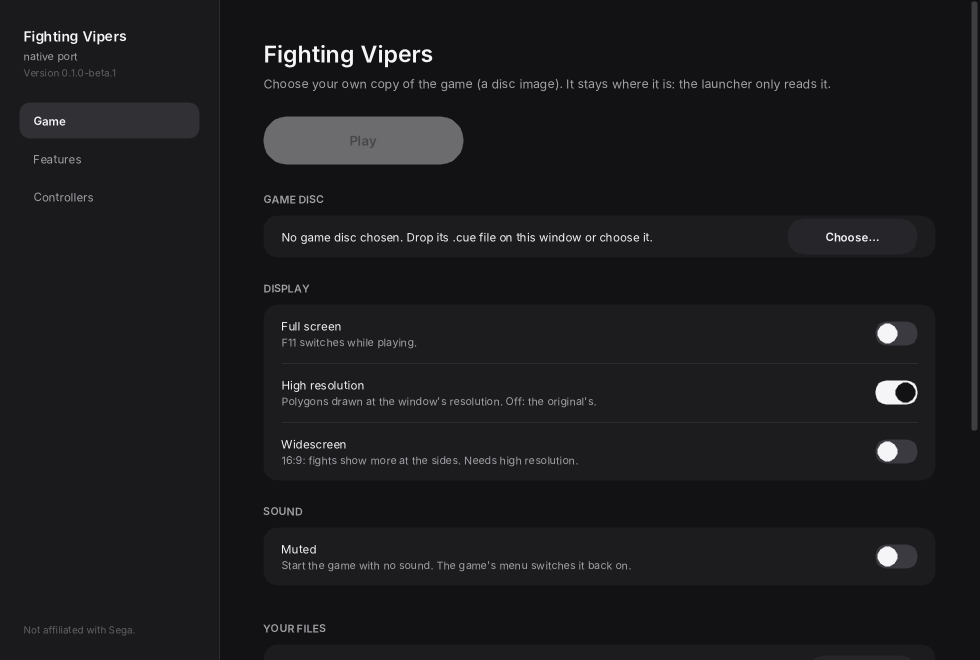
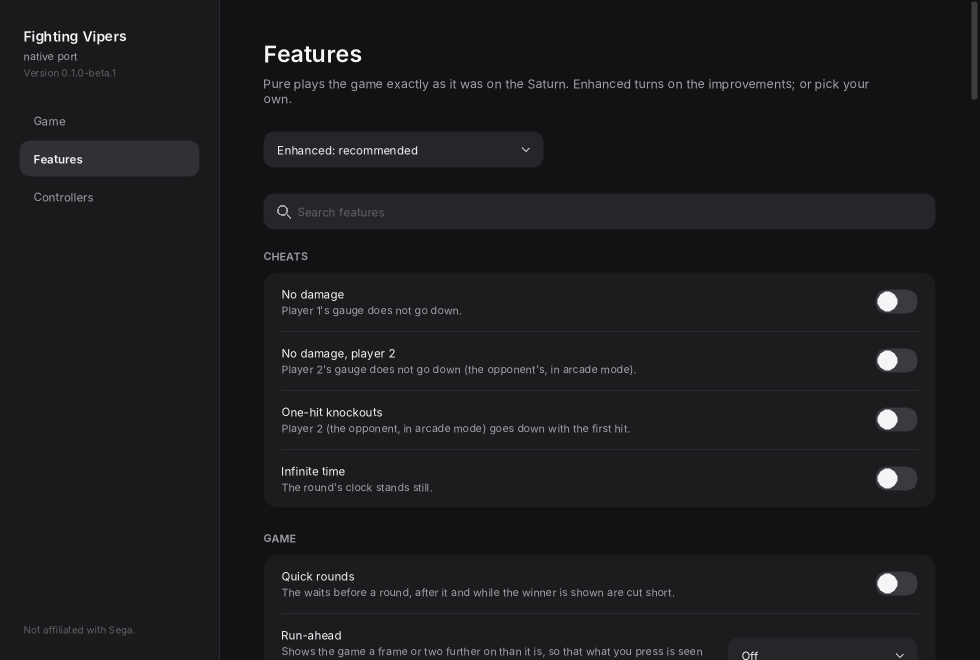
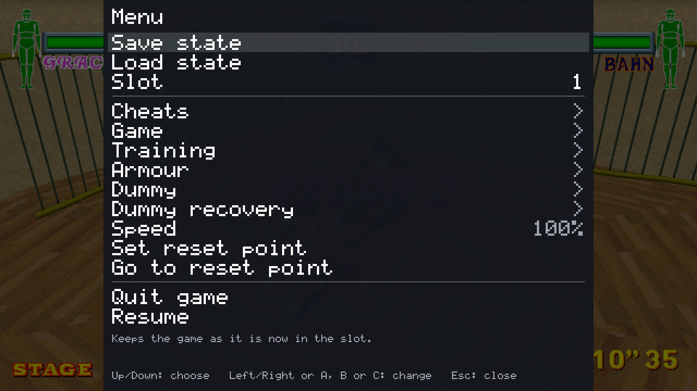

# The launcher, the controls and the menu

## Its pages

The **first page** has your disc image (drop its `.cue` file on the window, or choose it), the display's
switches (full screen, high resolution, widescreen) and **Play**. The launcher checks that the disc image is
the release this port is made from (USA, `MK-81041`, V2.000) and remembers where it is; it never copies,
moves or changes it. On SteamOS, **Add to Steam** puts the game in Game Mode.

### The Features page

**Pure** plays the game exactly as it was on the Saturn; **Enhanced** turns on the improvements; or choose
your own. A feature changed in the in-game menu is kept here too. Beside the [training aids](TRAINING.md) and
the [picture's options](PICTURE.md):

- **Armour** (one at a time): armour that stays on (it takes no damage, and armour knocked off is put back),
  an opponent without it, or nobody with it.
- **Cheats**: no damage (for player 1, or player 2), one-hit knockouts, infinite time (the round's clock
  stands still).
- **Quick rounds**: the waits before and after a round cut short.

### Run-ahead

Off, 1 frame or 2 frames (the Features page, or the menu's Game page): what you press is seen that much
sooner, with the game running exactly as without it. It takes two or three times the processor: too much for
a Steam Deck, where it plays below full speed.

## Controllers

Every key and gamepad button can be changed per player on the launcher's **Controllers** page, for two
players. The usual layout:

| Saturn pad | Keyboard | Gamepad |
| --- | --- | --- |
| Directions | Arrows | D-pad or left stick |
| A / B / C (guard, punch, kick) | Z / X / C | The lower buttons |
| X / Y / Z | A / S / D | The shoulders and the top button |
| L / R | Q / E | Triggers |
| Start | Return | Start |

The Controllers page also has **Punch + kick**, **Guard + punch**, **Guard + kick** and **Guard + punch +
kick**: buttons pressed together, held as one. They have no key or button until you give them one.

## Keys while playing

| Key | What it does |
| --- | --- |
| **Esc**, **F1**, or the gamepad's Back button | Opens and closes the in-game menu |
| **F11** | Full screen |
| **F5** / **F9** | Save / load a state in the slot; **F6** / **F7** the slot before and the next |
| **F2** / **F3** | Set the reset point / go back to it (a gamepad's right stick's click does both) |
| **F4** / **F8** | Pause / go on one frame |
| **-** / **=** | Slower / faster: 100, 50 or 25 percent |
| The right stick, or **I** / **J** / **K** / **L**; **U** / **O** | With the free camera on: turn it; come nearer and go farther |

The **in-game menu** stops the game while it is open: save and load a state (nine slots), a page for each
kind of feature, the speed, the reset point, and **Quit game**, which is how you leave (Esc only closes the
menu). Up and down choose a row; A, B, C or Start change it or go into a page; left and right change a row
with several values and leave a page.

## Updates

The launcher checks for a new version when it opens (its Updates card has the switch) and can update itself
in place: it downloads the new version for your system, checks it and every file that changed against the
release's list, and only then puts them in place; if anything goes wrong nothing is changed. Your settings,
saves and save states are kept. A beta is offered newer betas and releases; a release only releases.

## Your files

Settings, saves and save states are kept in your user folder:

| System | Folder |
| --- | --- |
| macOS | `~/Library/Application Support/Fighting Vipers/` |
| Linux, SteamOS | `~/.local/share/Fighting Vipers/` |
| Windows | `%APPDATA%\Fighting Vipers\` |

Delete it to start over. Your disc image is only ever read.

**Portable mode**: to keep them beside the program instead (on a drive you carry), put an empty file named
`portable.txt` beside the launcher (on macOS, beside the app, not inside it). They then go in a `user` folder
there. The first time, if your user folder already has them, the launcher offers to copy them over; nothing
is taken from your user folder. Take `portable.txt` away and the launcher uses your user folder again;
nothing is moved either way. The folder has to be one you can write to, or the launcher says so.
