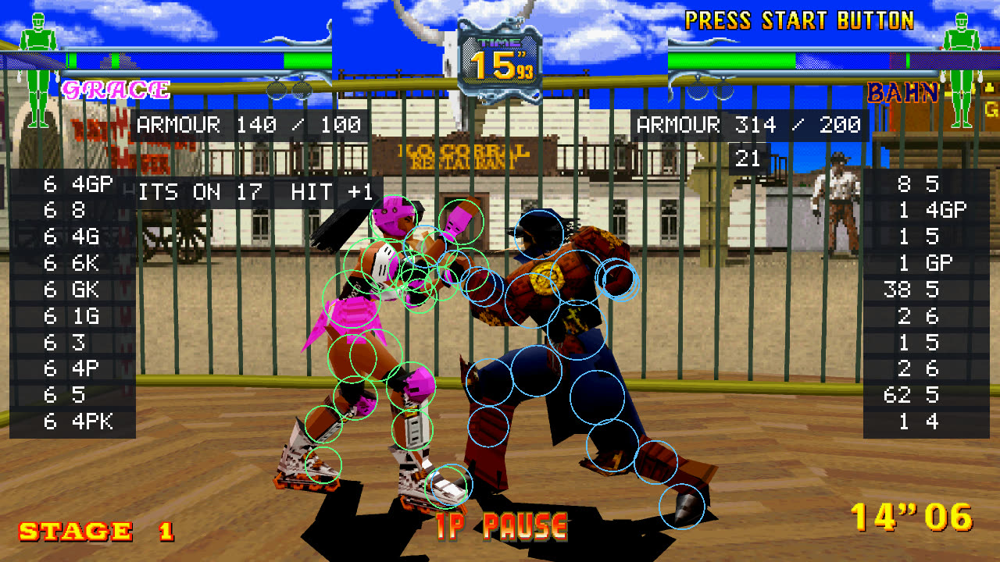

# Training mode

The training aids work in the game's own **TRAINING MODE** (on its main menu) and stay off in the other
modes, so an aid left on does nothing in arcade or versus. They are switches on the launcher's Features
page and on the in-game menu's Training page; the menu and the settings keep what you chose either way.

## The displays

| Aid | What it shows |
| --- | --- |
| Input display | Down each side, each fighter's last ten inputs, the newest at the top, each with the frames it was held, in number pad notation for a fighter facing right (6 forward, 4 back, 2 down, 8 up, 5 nothing), then G, P, K for guard, punch, kick. The game's own play is shown the same way. |
| Damage readout | By each gauge, what the last hit took off it, and for a combo the number of hits and what they took together. A combo is hits between which the fighter hit could not act. |
| Frame data | After a move hits or is guarded: the frame of the move it hit on, and how many frames sooner (+) or later (-) than the other its fighter can act again (`HITS ON 9  HIT +0`). A throw is shown once both can act again (`GRAB 1  DMG ON 75  +112`, or `ESCAPED` when the thrown fighter struggled free). Knockdowns and the like are not shown. |
| Armour readout | By each gauge, what is left of the upper and the lower armour, or OFF. |

There is no stun readout: the game keeps no stun or dizzy value.

## Move data

By the gauge of whoever attacked, the last attack:

- its number in the game and its **level**: HIGH misses a crouching fighter, MID hits a crouching guard,
  LOW hits a standing guard, MID+ is as MID but a crouching guard takes all of it, GROUND hits a fighter
  lying down;
- **start-up, active and recovery** frames (`START 9 ACT 1 REC 14`);
- **damage** off the other's gauge and onto its armour (`DMG 9  ARMOUR 12`);
- the **advantage on hit and on guard** once each has been seen (`HIT +0  GUARD -2`; `HIT DOWN`: it knocks
  down). A throw has its number and when the thrown fighter is free.

Every attack done is kept in a table by character and move for as long as the game runs, and written to
`moves-<character>.csv` beside the settings. The damage and the advantages depend on the other's armour, so
a table to set against a published one wants one armour setting throughout.

**Move log** writes every attack done as a line of `frame_data.csv` beside the settings: the player, the
character, what was pressed for it, the move, its kind and level, start, active and recovery, the result
(hit, guard, knockdown, throw, escaped, or nothing), the advantage, and the damage to the gauge and to the
armour.

## Hit overlay and hit view

What the game tests for hits: each body as the game has it, 22 balls. Outlined: parts that can be hit (grey:
not now); red: the parts the fighter's move attacks with; yellow: parts an attack is touching.

- **Hit overlay** draws them over the fighters. In fast motion they are a frame behind the picture.
- **Hit view** draws them in a panel, seen from the side of the line between the fighters, which shows
  overlap the overlay cannot.

## Throw range

On the ground before each fighter, dots along the reach of its throw, lit while the game itself would let
the throw happen; in the hit view, the same along the ground. And a line each: how far apart, the reach, and
the verdict (OK; FAR; TURNED, one of the two doesn't face as a throw wants; NO, the other can't be thrown as
it is; WAIT, a hit or a guard was too recent). While a fighter is being thrown its line counts the presses
towards struggling free (`STRUGGLE 12 OF 19`).

## The dummy

The dummy is the opponent of whoever plays (player 2 when both do). One of these at a time:

| Dummy | What it does |
| --- | --- |
| Stands, crouches | Stands or crouches still. |
| Guards, guards low | Stands and guards, or crouches and guards. |
| Guards high or low | Guards each attack standing or crouching, by chance. |
| Guards after a hit | Guards for a second after each hit it takes: what still hits then is a true combo. |
| Guards and counters | Counters as soon as it can after guarding or being hit: what it beats was not safe. |
| Jumps | Jumps instead of fighting. |
| Record | Your pad plays the opponent while your own fighter stands, and up to ten seconds are kept. |
| Replay | The opponent does what was recorded, over and over. Left and right are kept as towards and away from the other fighter. |

And with it:

- **Dummy counter**: what it counters with: a punch, a kick, a low kick, a throw, or the recording.
- **Dummy wake-up** (also with the game's own play): what it does on the first frame it can act after being
  down: guards, punches, kicks, kicks low, presses guard and punch, does the recording, or one of them at
  random.
- **Dummy recovery** (also with the game's own play): how it gets up when knocked down: lands on its feet,
  gets up fast, rolls back, forward or aside, gets up kicking or kicking low, or one of these at random.
- **Dummy struggles in throws**: off, always or at random. The game breaks a throw after enough presses, and
  the dummy gets out unhurt.
- **Dummy answers now and then**: its counter and its wake-up only one time in two, by chance, so you can't
  learn when it will.

## Practice tools

These work in every mode, not only in training:

| Tool | Keys |
| --- | --- |
| The reset point: a moment kept to go back to | **F2** sets it, **F3** goes back to it; on a gamepad the right stick's click does both (the first click sets it); or the menu |
| Pause | **F4** stops the game and lets it go on |
| Frame advance | **F8** goes on one frame (and stops the game if it was running) |
| Slow motion | 100, 50 or 25 percent: the **-** and **=** keys, or the menu's Speed (no sound in slow motion) |
| Save states | Nine slots: **F5** saves, **F9** loads, **F6** / **F7** the slot before and the next |

**Gauges refill**, a training aid: a gauge is whole again a moment after its fighter was last hit.

The toolkit's notes ([satrecomp/docs/FEATURES.md](../satrecomp/docs/FEATURES.md)) have how each aid works and
how it was checked.
